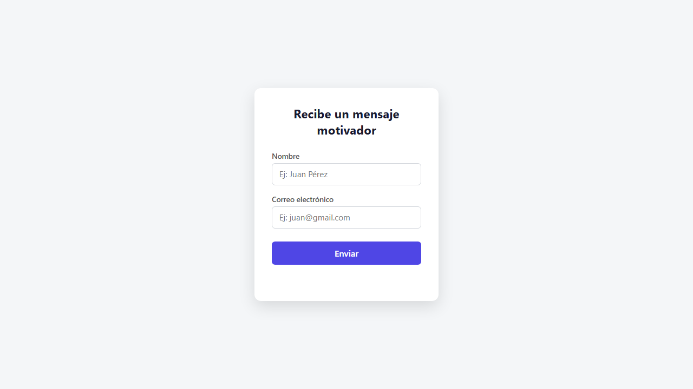
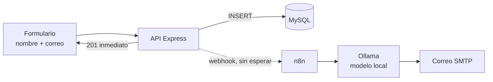

# Registro de usuarios con mensaje de IA

Un formulario de registro que, al enviarse, guarda al usuario en MySQL y dispara un flujo de **n8n** donde una **IA local (Ollama)** escribe un mensaje alentador y con humor que le llega por correo.

El punto de este proyecto es la **automatización**: el backend responde al instante y la IA trabaja en segundo plano, sin que el usuario espere.





## Decisiones de diseño

- **Fire-and-forget:** la API no espera a n8n ni a la IA. Si n8n está caído, el registro igual funciona y el error solo queda en el log.
- **Validación en el servidor:** el formulario valida, pero la API no confía en él (`backend/controllers/validar.js`, con pruebas).
- **Correo único:** la columna `email` es `UNIQUE`; un correo repetido responde `409` y no dispara un segundo mensaje.
- **Configuración por variables de entorno**, sin credenciales en el código.

## Stack

Node.js 22+, Express 5, MySQL (XAMPP o cualquier MySQL/MariaDB), n8n, Ollama (el flujo usa `llama3.2`; sirve cualquier modelo, y el código del flujo quita las etiquetas `<think>` de los modelos que razonan, como `deepseek-r1`), HTML/CSS/JS sin framework.

## Cómo correrlo

1. **Base de datos:** importa `database/schema.sql` (phpMyAdmin → SQL, o `mysql < database/schema.sql`).
2. **Backend:**

   ```bash
   cd backend
   npm install
   cp ../.env.example .env   # opcional: los valores por defecto sirven con XAMPP
   npm start
   ```

   Abre http://localhost:3000. El mismo servidor entrega el formulario.
3. **n8n + Ollama:** n8n corre en Docker con el [self-hosted AI starter kit](https://github.com/n8n-io/self-hosted-ai-starter-kit) de n8n (`docker compose up -d`) y Ollama del mismo compose (perfil `cpu`: `docker compose --profile cpu up -d`), con el modelo `llama3.2`.
   - En n8n: **Import from file** → `n8n/workflow.json`.
   - Nodo *Ollama Chat Model*: usa la credencial con la URL `http://ollama:11434` (Ollama del compose). Si prefieres el Ollama instalado en tu máquina, la URL es `http://host.docker.internal:11434`.
   - Nodo *Send email*: crea una credencial SMTP (con Gmail, una contraseña de aplicación) y cambia el campo *From*.
   - Publica el flujo (*Active*). Si lo pruebas sin publicar, usa la URL `/webhook-test/…` en `N8N_WEBHOOK_URL`.

   Dos tropiezos conocidos:
   - Si un antivirus intercepta el TLS (Avast, por ejemplo), el nodo *Send email* falla por certificado; activa **Ignore SSL Issues** en ese nodo.
   - Si Ollama devuelve `unsupported toolchain` en una GPU NVIDIA antigua, actualiza el controlador de la tarjeta o fuerza CPU (en la API, `"options": {"num_gpu": 0}`). En CPU un mensaje tarda cerca de un minuto.

Pruebas: `cd backend && npm test`.

## Límites

Es un proyecto de práctica: no hay límite de peticiones ni verificación del correo, así que una API pública permitiría enviar correos a direcciones ajenas. Antes de publicarla en internet habría que agregar un captcha o confirmar el correo.

Basado en una guía de clase (Soy Waz); el código y los ajustes de configuración, validación y documentación son propios.
